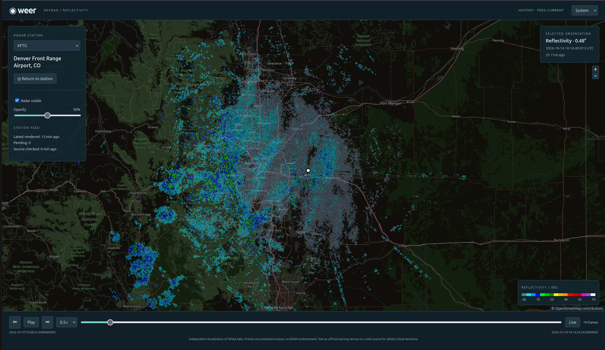
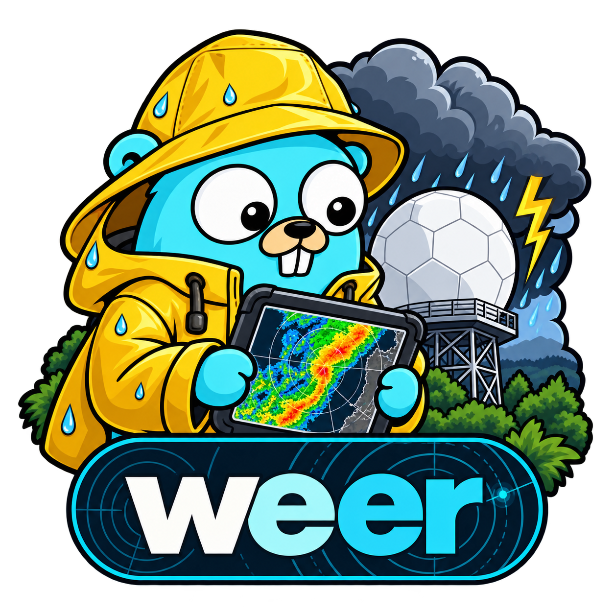

# Weer

Weer is a small, self-hosted U.S. NEXRAD radar viewer. A Go service downloads completed Level II volumes, stores metadata in SQLite, runs a bounded Python/Py-ART subprocess, and serves transparent reflectivity images on an OpenLayers map. React provides live updates and historical playback.

**Independent visualization of NOAA data.** Images are processed output, not original unaltered NOAA products. NOAA does not endorse Weer. This is not an official warning service and must not be the sole source for safety-critical decisions.



## Run locally

Requirements: Linux or macOS, Go 1.26+, Node.js 22.12+ (24 recommended), pnpm 11.25, Python 3.12, and [uv](https://docs.astral.sh/uv/). Production requires the Python environment as well as the Go executable and built frontend.

```sh
make processor
make build
./weer serve --config configs/weer.yaml
```

Open <http://127.0.0.1:8080>. The example config enables KFTG, Denver Front Range Airport. The service checks the unsigned `unidata-nexrad-level2` bucket, processes the newest observation first, and backfills two hours. No AWS credentials, AWS CLI, or paid API are needed. A missing or stale feed is displayed honestly; source availability is not guaranteed.

Default radar coverage is 230 km and 1024×1024 pixels. The bundled local and Docker configs show an OpenStreetMap background beneath the radar, with visible contributor attribution. Tiles load directly in your browser and require internet access. Set `basemap_url` and `basemap_attribution` to empty strings to disable the background, or supply another HTTPS XYZ tile URL and its required attribution. OpenStreetMap tiles are for interactive viewing, subject to the [tile usage policy](https://operations.osmfoundation.org/policies/tiles/). Radar images are never tiles.

## Stations and settings

Use the theme selector in the header to choose Light, Dark, or System. System follows your device’s appearance; your selection is saved in this browser. Themes style the interface and map controls. The bundled OpenStreetMap background uses its original colors in light mode and a dark color filter in dark mode. The filter applies only to the basemap layer, preserving radar colors, station markers, and attribution. Custom XYZ basemaps keep their original colors.

Edit `configs/weer.yaml`, then restart. Only configured stations are listed or ingested. Each station needs its four-character ID, documented name, latitude, and longitude; obtain these from [NOAA NCEI station records](https://www.ncdc.noaa.gov/cdo-web/datasets/NEXRAD2/stations/NEXRAD%3AKFTG/detail). KFTG is the bundled minimal catalog. Do not infer locations from station IDs. Use the station selector in the left panel to switch feeds.

Settings include polling, history, retention, concurrency, download limits, retry count, Python path/timeout, raster size/coverage, stale threshold, and basemap. Configuration rejects unknown keys. Paths resolve relative to the working directory. The data directory is exclusively locked: run one service or import command per data directory, with its database inside that directory. A rendering configuration/version change requeues retained volumes at startup.

## Import an existing volume

Stop the service before local import; import uses the same validated rendering and persistence path:

```sh
./weer ingest --file /path/to/KFTG20240520_000059_V06 --config configs/weer.yaml
./weer serve --config configs/weer.yaml
./weer version
```

Both archive containers and gzip-wrapped archives are accepted. The file's decoded station must be configured. Originals remain on disk for retention. Imported historical observations are kept for the configured retention duration **after import**, while their true observation dates remain visible and their feed is stale. Automatic observations expire at nominal source time plus retention. A repeated identical import reuses its existing ready frame.

Use the timeline, previous/next, speed selector, and Play to replay actual observations. Scrubbing exits live-follow; newly arriving scans do not replace a selected historical frame. Live returns to the latest ready scan. URLs preserve station and historical scan selection. A valid all-masked sweep is explicitly identified, independently of missing data or errors.

## Docker Compose

```sh
docker compose up --build -d
docker compose logs -f weer
```

The image includes Python, Py-ART, Go executable, and frontend, and runs as UID/GID 10001. The named volume preserves the database, raw volumes, and frames. The example port binds only to localhost. For a bind-mounted data directory, create it and grant UID 10001 write access before starting. Edit `configs/docker.yaml` for container settings. Stop Compose before importing into its volume with a one-off container.

Neither the API nor the UI provides authentication. Any deployment exposed to other users needs appropriate reverse-proxy and access controls. Do not expose the default service directly to the internet.

## Development and checks

```sh
make test                 # offline tests; dependencies must already be installed
cd web && pnpm dev       # Vite proxy to Go :8080
make smoke               # opt-in network test: two named archived NOAA volumes
```

The smoke test verifies SHA-256, imports two real observations, serves the API, verifies frame metadata/PNG, restarts, and checks frame reuse. It uses a temporary data directory. It is separate from the default synthetic/mocked tests. See [sources](docs/sources.md), [architecture](docs/architecture.md), [processor contract](docs/processor-contract.md), [HTTP API](docs/api.md), and [validation record](docs/validation.md).

Limitations: reflectivity only, one selected station, selected-elevation sweep rather than a surface estimate or composite; no numeric pixel interrogation, mosaics, warning overlays, or authentication. Coverage crossing the antimeridian or reaching 85° latitude is rejected. Raster resolution and angular support can omit very narrow features; these are visualization products, not analysis-ready numerical grids.

Application code is MIT licensed; the existing repository license is preserved. Scientific dependencies retain their own licenses.


