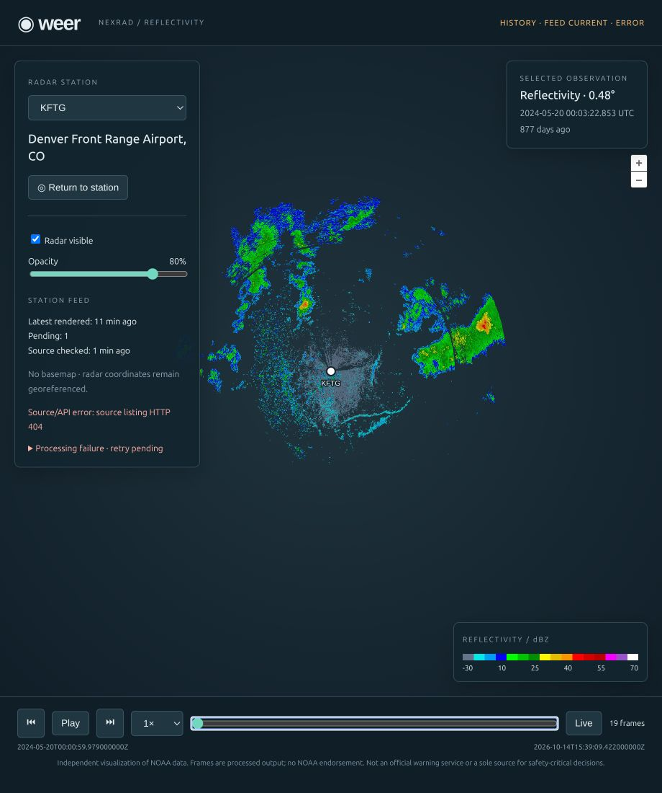

# Validation record — 2026-10-14

## Passed locally

- `go test ./...`, then `go test -race ./...`: all six internal packages passed. Coverage includes UTC date boundaries, paginated listings, unsupported-object filtering, newest-first discovery, deduplication/restart recovery, retry backoff, inactive-only retention and file deletion, download failure/atomicity/size limits, processor failure/timeout, manifest identity/path/time validation, configuration validation, API ranges/ordering, and preventing local imports from inventing a fresh source timestamp.
- `go vet ./...` and `go build -o weer ./cmd/weer` passed, using Go 1.27.2 with the committed module dependency checksums.
- Python 3.12 / locked Py-ART 2.2.4: six offline `unittest` tests passed. They cover lowest/latest sweep selection, missing reflectivity, all-masked output, north/east/south/west orientation, stable projected extents, color consistency, missing sectors/rays, and unsupported polar coverage.
- TypeScript check, five Vitest playback tests, and Vite production build passed. Vite reports a non-fatal bundle-size warning (approximately 560 kB JavaScript before gzip, 169 kB gzip).
- `git diff --check` passed.
- `docker compose config --quiet` passed.
- Multi-stage Docker build passed. Production image runs as UID/GID 10001. The same six processor tests passed inside the image.

## Real-data checks

`WEER_KEEP_SMOKE=1 bash scripts/smoke.sh` passed with the two named, checksum-verified May 2024 KFTG objects in [sources.md](sources.md). Both produced transparent PNGs and validated manifests. HTTP served their actual sweep times/elevations. Duplicate import reused the frame. A service restart preserved both frame IDs and images.

A separate real gzip-wrapped version of the first archive decoded successfully, including when imported through the Go executable inside the non-root production container. The container's health, retained scan query, image, manifest, and conditional ETag/304 were checked. The final rebuilt container reused the same persisted real frame after restart. Temporary validation services and the test Docker volume were removed afterward.

Unsigned live discovery also ran against the configured public bucket. It discovered, downloaded, and rendered October 14, 2026 KFTG volumes. The browser displayed a current feed, including a selected sweep at 15:33:20.540 UTC. Historical selection, Play/Pause, timeline scrubbing, and Live were exercised with real archived and current observations; the URL reflected historical selection.

A deliberately corrupt archive was rejected by Py-ART with `No MSG31 records found`. A deliberately nonexistent test bucket produced HTTP 404. Status retained the last successful check and the prior ready observations, exposed retry eligibility, and the browser showed both source and processing failures while still displaying the retained historical radar. These failures were confined to temporary test configuration/data, not the shipped example config.

## Not claimed

Hosted GitHub Actions execution, multi-station real-data integration beyond KFTG, long-duration endurance testing, disk-full/power-loss testing, and a full `docker compose up` session were not run. Docker was validated with direct image/container commands plus Compose configuration validation. Synthetic processor fixtures alone are not evidence of real NEXRAD decoding; the separate checks above supply that evidence.
